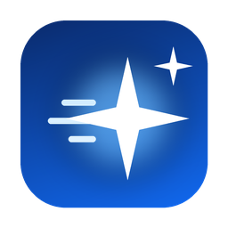
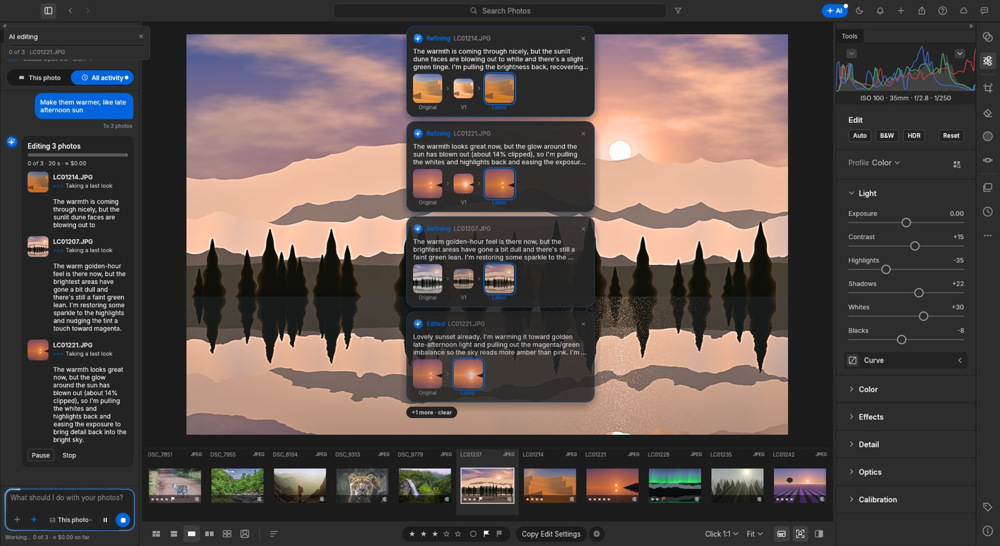
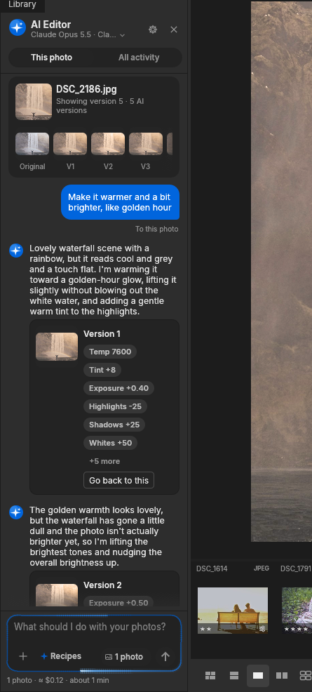
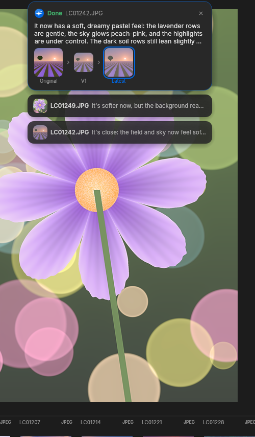
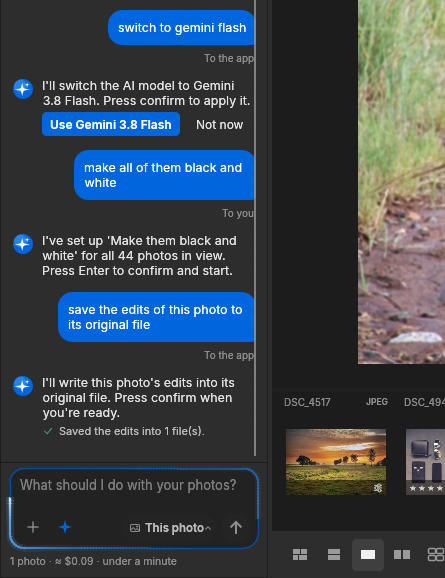

<h1>ZippyCraft</h1>

<b>The AI photo editor that works through your shoot for you.</b> 
Tell it what you want in plain words. It edits, culls and checks every photo, one at a time, and tells you what it did.

&nbsp;

<b>Free for 14 days</b>, so you can see if it fits your workflow. 
Download it, plug in your AI, and hand it your next shoot.

 

 

<h2>What it does</h2>

<table>
<tr>
<td width="50%" valign="top">
<h3>Edits from a sentence</h3>

<i>"If it's blurry, reject it. Otherwise fix the lighting and keep skin natural."</i> 
ZippyCraft looks at each photo, sets the exposure, contrast, white balance and colour itself, then checks its own work and corrects it until it matches what you asked.

</td>
<td width="50%" valign="top">
<h3>Culls the shoot</h3>

Out-of-focus, shaken and badly exposed frames are flagged as rejected (never deleted unless you say so). The keepers get star ratings and the best get picked.

</td>
</tr>
<tr>
<td valign="top">
<h3>Talks you through it</h3>

At every step the AI says what it sees and what it changed: <i>"Close, but the sky has blown out, so I'm pulling the highlights back."</i> Each photo keeps its own conversation, so you can come back later and say <i>"darker blacks please"</i>.

</td>
<td valign="top">
<h3>Every version kept</h3>

The original, each change the AI made and your own tweaks are all kept as versions. Hover to compare, click to go back, and carry on from there. Nothing is ever overwritten.

</td>
</tr>
<tr>
<td valign="top">
<h3>Matches a look</h3>

Drop in a reference photo of the style you love and ask for <i>"this look"</i>. Save your favourite instructions as recipes: Bright &amp; Airy, Moody &amp; Cinematic, Real Estate, Black &amp; White and your own.

</td>
<td valign="top">
<h3>Understands what you mean</h3>

Ask a question and it answers. Say <i>"do the same to the first 20"</i> and it selects them and sets it up for you. Ask it to save your edits into the files, export, rate or flag, and it offers a button to do it.

</td>
</tr>
</table>

&nbsp;&nbsp;

&nbsp;&nbsp;

<h2>How it works</h2>

<ol>
<li><b>Bring in your photos.</b> Point ZippyCraft at a folder of JPEGs or raw files from your camera. It's a full photo library and raw developer: everything you'd expect for sorting, rating and editing by hand is here too.</li>
<li><b>Select photos and say what you want.</b> Select one, a handful or the whole shoot, click <b>Edit with AI</b> and type it in your own words, or pick a recipe.</li>
<li><b>Watch it work, then fine-tune.</b> Each change pops up as it happens with the before and after. Reply to any photo to adjust it, or go back to any version.</li>
<li><b>Export.</b> Your originals are never touched: edits are stored separately and every step can be undone.</li>
</ol>

<h2>Plug in your AI</h2>

ZippyCraft works with the AI you choose. Paste your own API key in Settings and pay your provider directly for what you use, with no markup. The app shows an estimate before every batch.

<table>
<tr><th>Provider</th><th>Models</th><th>Roughly, per 100 photos</th></tr>
<tr><td>Anthropic</td><td>Claude Opus, Sonnet, Haiku</td><td>$0.30 to $12</td></tr>
<tr><td>OpenAI</td><td>GPT-6 Astra, Terra, Luna</td><td>$0.30 to $30</td></tr>
<tr><td>Google</td><td>Gemini Pro, Flash, Flash-Lite</td><td>$0.30 to $6</td></tr>
<tr><td>DeepSeek</td><td>DeepSeek Flash</td><td>under $1</td></tr>
<tr><td>Others</td><td>Any OpenAI-compatible service (OpenRouter and more)</td><td>depends on the model</td></tr>
</table>

Estimates at list prices; the bigger models are slower and more careful, the small ones quick and cheap.

<h2>What to expect</h2>

<ul>
<li><b>Your photos stay yours.</b> The AI sees small previews, never your original files, and only when you ask it to work.</li>
<li><b>Nothing is destructive.</b> Rejected photos are flagged, not deleted. Every edit can be undone or rolled back to any version.</li>
<li><b>It's fast.</b> Several photos are worked on at once, so a few hundred photos take minutes, not an evening.</li>
<li><b>You stay in charge.</b> Choose how hard it works (Fast, Balanced or Thorough), what happens to rejects, and which photos it touches.</li>
<li><b>Updates itself.</b> When a new version is out, ZippyCraft offers it and installs it in one click.</li>
</ul>

<h2>Install</h2>

<table>
<tr>
<td width="50%" valign="top">
<h3>Mac</h3>

One download for both Apple Silicon (M1, M2, M3, M4) and Intel Macs. Signed and notarized by Apple.

<ol>
<li>Download the <code>.dmg</code> from the <a href="https://github.com/inventabotnow/zippycraft-download/releases/latest">latest release</a></li>
<li>Open it and drag <b>ZippyCraft</b> into Applications</li>
<li>Open ZippyCraft from Applications</li>
</ol>

macOS 12 Monterey or later.

</td>
<td width="50%" valign="top">
<h3>Windows</h3>

One file, nothing to install.

<ol>
<li>Download the <code>.exe</code> from the <a href="https://github.com/inventabotnow/zippycraft-download/releases/latest">latest release</a></li>
<li>Double-click it</li>
<li>If Windows SmartScreen appears, click <b>More info</b>, then <b>Run anyway</b></li>
</ol>

Windows 10 or 11, 64-bit.

</td>
</tr>
</table>

<h2>Your free trial</h2>

Open the AI panel, enter your name and email, and your <b>14-day free trial</b> starts. After that, extend your licence from the app whenever you're ready. Editing by hand keeps working either way: the licence is only for the AI.

<b>Questions</b>

 

<b>Do I need to know how to edit photos?</b> 
No. Describe the result you want ("brighter and warmer", "moody, like a film still") and the AI does the editing. If you do know, every slider it touched is there for you to adjust.  

<b>Does it work with raw files?</b> 
Yes: raw files from most cameras, as well as JPEG, PNG, TIFF, HEIC and more.  

<b>Will it delete my photos?</b> 
No. Photos it thinks are unusable are flagged as rejected so you can review them. Moving them to the bin is an option you have to turn on.  

<b>Which AI should I pick?</b> 
Start with a mid-priced model (Claude Sonnet, GPT-6.1 Terra or Gemini Flash). Use the top models for your most important shoots, and the cheapest ones for quick culls.  

<b>Is my API key safe?</b> 
It's stored only on your computer and sent only to the provider you chose.

 

ZippyCraft is built on open-source photo software (see About in the app for the full credits).

