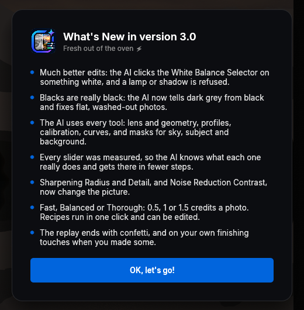
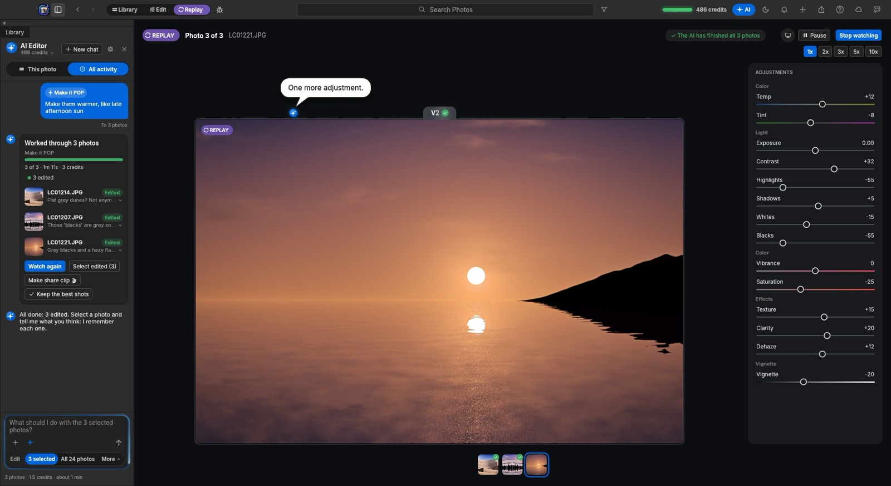

<h1>ZippyCraft</h1>

<h3>Tell it how you want your photos. It edits the whole shoot for you.</h3>

An AI photo editor for photographers. Describe the look in plain words, and ZippyCraft edits, culls and checks every photo, 
one at a time, telling you what it sees and what it changed.

&nbsp;

<b>Free to try.</b> Download it, enter your name and email, and your free AI credits are waiting.

 

Live: the AI edits each photo, looks at the result, and keeps going until it's right.

 

<h2>✨ New in 3.0: the best edits yet</h2>

<table>
<tr>
<td width="55%" valign="top">

**Whites come out white.** The AI now uses the White Balance Selector, the way a pro retoucher does: it finds something in the photo that should be white (a dress, a shirt, a tablecloth) and clicks on it. If it lands on a lamp, a candle or a shadow, ZippyCraft undoes it and has it pick again.

**Blacks that are really black.** The AI tells dark grey from black, so flat, washed-out photos don't slip through as "finished".

**Every tool in the app.** Lens corrections, geometry, camera profiles, calibration, curves, and masks for the sky, the subject and the background, all at the AI's fingertips.

**It knows what every slider really does.** We measured every one of them on test charts and real photos, and taught the AI the results. It reaches the look in fewer, surer steps.

**Sharper, cleaner detail.** Sharpening Radius and Detail, and Noise Reduction Contrast, now do their full job.

</td>
<td width="45%" valign="top" align="center">

</td>
</tr>
</table>

<h2>What it does</h2>

<table>
<tr>
<td width="50%" valign="top">
<h3>🗣️ Edits from a sentence</h3>

<i>"If it's blurry, reject it. Otherwise fix the lighting and keep skin natural."</i> 
ZippyCraft sets the exposure, contrast, white balance and colour of each photo itself, then checks its own work and corrects it until it matches what you asked.

</td>
<td width="50%" valign="top">
<h3>🎯 Culls the shoot</h3>

Out-of-focus, shaken and badly exposed frames are flagged as rejected (never deleted unless you say so). The keepers get star ratings, and after a run it offers to keep the best of photos taken seconds apart.

</td>
</tr>
<tr>
<td valign="top">
<h3>💬 Talks you through it</h3>

At every step the AI says what it sees and what it changed: <i>"Close, but the sky has blown out, so I'm pulling the highlights back."</i> Each photo keeps its own conversation, so you can come back later and say <i>"darker blacks please"</i>.

</td>
<td valign="top">
<h3>🕘 Every version kept</h3>

The original, each version the AI made and your own tweaks are all kept. Hover to compare, click to go back, and choose the one to keep. Nothing is ever overwritten.

</td>
</tr>
<tr>
<td valign="top">
<h3>🎨 Matches a look</h3>

Drop in a reference photo of the style you love and ask for <i>"this look"</i>. Recipes like Bright &amp; Airy, Moody &amp; Cinematic, Real Estate and Black &amp; White run in one click, and you can edit them or save your own.

</td>
<td valign="top">
<h3>🎬 Replays every edit</h3>

Watch the AI's work back, photo by photo, ending on your own finishing touches (and a little confetti 🎉). Make a share clip of the before and after for your clients or socials.

</td>
</tr>
</table>

&nbsp;

<h2>How it works</h2>

<ol>
<li><b>Bring in your photos.</b> Import a folder of JPEGs or raw files from your camera. ZippyCraft is a full photo library and raw developer, so everything you'd expect for sorting, rating and editing by hand is here too.</li>
<li><b>Select photos and say what you want.</b> One, a handful or the whole shoot. Type it in your own words, or pick a recipe.</li>
<li><b>Watch it work, then fine-tune.</b> Each change pops up as it happens, with the before and after. Reply to any photo to adjust it, or go back to any version.</li>
<li><b>Export.</b> Your originals are never touched: edits are stored separately and every step can be undone.</li>
</ol>

<h2>💳 Simple pricing: credits</h2>

The AI is built in. There's nothing to set up and no account with an AI company: you just use credits.

<table>
<tr><th>How carefully</th><th>Checks per photo</th><th>Credits per photo</th></tr>
<tr><td><b>Fast</b></td><td>up to 3</td><td>0.5</td></tr>
<tr><td><b>Balanced</b> (the default)</td><td>up to 5</td><td>1</td></tr>
<tr><td><b>Thorough</b></td><td>up to 9</td><td>1.5</td></tr>
</table>

<ul>
<li><b>Free credits to start</b> when you enter your name and email.</li>
<li><b>Top up</b> from inside the app whenever you like. Credits you buy never expire.</li>
<li><b>Plans</b> give you <b>300 credits every month</b> for less per photo.</li>
<li>If an edit fails before the AI changes anything, you get the credit back.</li>
</ul>

<h2>What to expect</h2>

<ul>
<li><b>Your photos stay yours.</b> The AI sees small previews, never your original files, and only when you ask it to work.</li>
<li><b>Nothing is destructive.</b> Rejected photos are flagged, not deleted. Every edit can be undone or rolled back to any version.</li>
<li><b>It's fast.</b> Several photos are worked on at once, so a few hundred photos take minutes, not an evening.</li>
<li><b>You stay in charge.</b> Choose how carefully it works, what happens to rejects, and which photos it touches.</li>
<li><b>Always up to date.</b> ZippyCraft updates itself when you open it, so you always have the newest version.</li>
</ul>

<h2>Install</h2>

<table>
<tr>
<td width="50%" valign="top">
<h3>Mac</h3>

One download for both Apple Silicon (M1, M2, M3, M4) and Intel Macs. Signed and notarized by Apple.

<ol>
<li>Download the <code>.dmg</code> from the <a href="https://github.com/inventabotnow/zippycraft-download/releases/latest">latest release</a></li>
<li>Open it and drag <b>ZippyCraft</b> into Applications</li>
<li>Open ZippyCraft from Applications</li>
</ol>

macOS 12 Monterey or later.

</td>
<td width="50%" valign="top">
<h3>Windows</h3>

One file, nothing to install.

<ol>
<li>Download the <code>.exe</code> from the <a href="https://github.com/inventabotnow/zippycraft-download/releases/latest">latest release</a></li>
<li>Double-click it</li>
<li>If Windows SmartScreen appears, click <b>More info</b>, then <b>Run anyway</b></li>
</ol>

Windows 10 or 11, 64-bit.

</td>
</tr>
</table>

<b>Questions</b>

 

<b>Do I need to know how to edit photos?</b> 
No. Describe the result you want ("brighter and warmer", "moody, like a film still") and the AI does the editing. If you do know, every slider it touched is there for you to adjust.  

<b>Do I need an AI account or an API key?</b> 
No. The AI is included. You only use ZippyCraft credits.  

<b>What happens when I run out of credits?</b> 
Your photos and edits are safe, and editing by hand, replays and exports keep working. Top up from inside the app to keep the AI going.  

<b>Does it work with raw files?</b> 
Yes: raw files from most cameras, as well as JPEG, PNG, TIFF, HEIC and more.  

<b>Will it delete my photos?</b> 
No. Photos it thinks are unusable are flagged as rejected so you can review them. Moving them to the bin is an option you have to turn on.

 

ZippyCraft is built on open-source photo software (see About in the app for the full credits).

